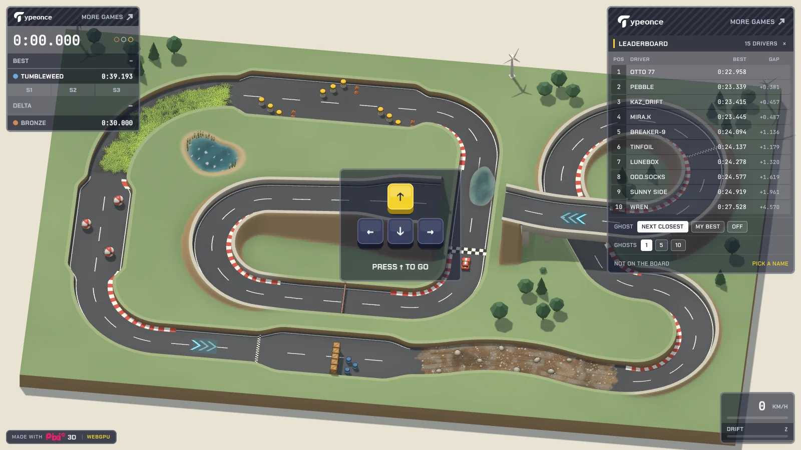
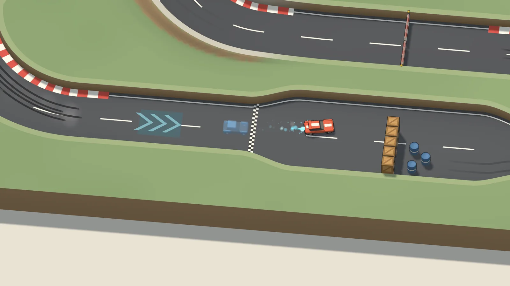
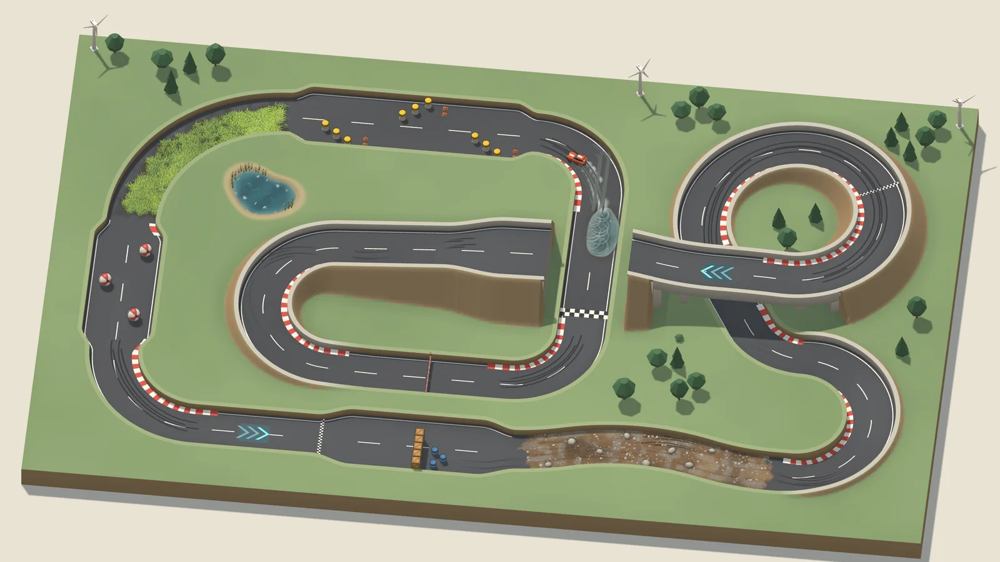
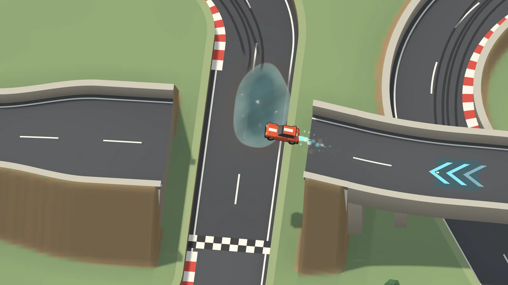

# Tabletop Grand Prix

**A time-attack racer on a toy track, against the whole world.** 🏁

<a href="https://tabletop-grand-prix.typeonce.games"><b>▶ Play in your browser</b></a> · free, nothing to install

<a href="docs/media/trailer.mp4">
  <picture>
    <source srcset="docs/media/tabletop-grand-prix.avif" type="image/avif">
    
  </picture>
</a>

<a href="docs/media/trailer.mp4">Watch the 25-second trailer</a>

## 🌍 Race the world

One global leaderboard. Click anyone on it and their lap becomes your ghost.

## 👻 Race the pack

Race one ghost, or a field of ten at once, each name flashing as you pass it.

<table>
  <tr>
    <td></td>
    <td></td>
  </tr>
  <tr>
    <td align="center">the run just above yours</td>
    <td align="center">a whole field of ghosts</td>
  </tr>
</table>

## ⏱️ Set the fastest lap

One track, half a minute a lap, bronze, silver and gold to earn.

## 💥 Everything moves

Smash the crates, clear the gap, hop the rocks.

<table>
  <tr>
    <td></td>
    <td></td>
  </tr>
</table>

## 🌀 Drift

Hold `Z` through a turn and slide round it.

## 🎮 Play

**[tabletop-grand-prix.typeonce.games](https://tabletop-grand-prix.typeonce.games)**, on a computer, with a keyboard or a gamepad.

| | Keyboard | Gamepad |
| --- | --- | --- |
| Gas | `↑` or `W` | right trigger or A |
| Brake | `↓` or `S` | left trigger or B |
| Steer | `←` `→` or `A` `D` | left stick or d-pad |
| Drift | `Z` | right bumper |
| Start again | `R` | Y or Start |
| Sound | `M` | left stick click |

Made by [Sandro Maglione](https://typeonce.games) with [ritmo](https://ritmo.typeonce.dev) and [PixiJS 3D](https://pixijs.com/3d).

## License

Apache 2.0 ([LICENSE](LICENSE)). Keep the [NOTICE](NOTICE) crediting Sandro Maglione at [typeonce.games](https://typeonce.games); the Typeonce and PixiJS logos are not covered.

---

[Developing](DEVELOPMENT.md) · [The design](docs/design.md) · [The leaderboard server](docs/server.md) · [More games](https://typeonce.games)
