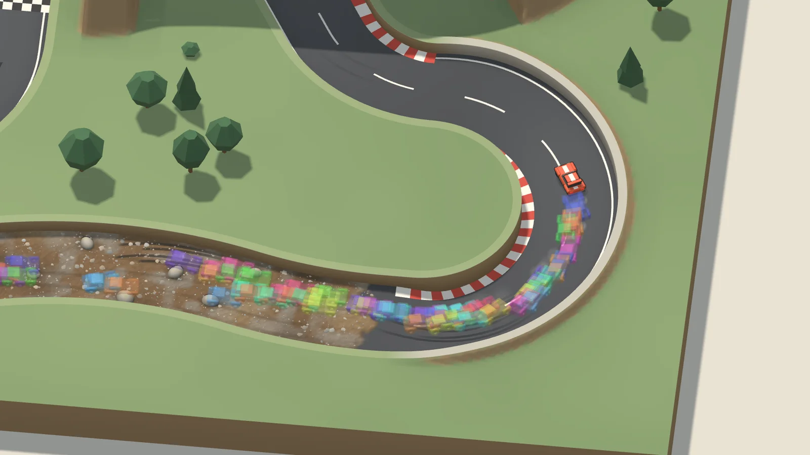
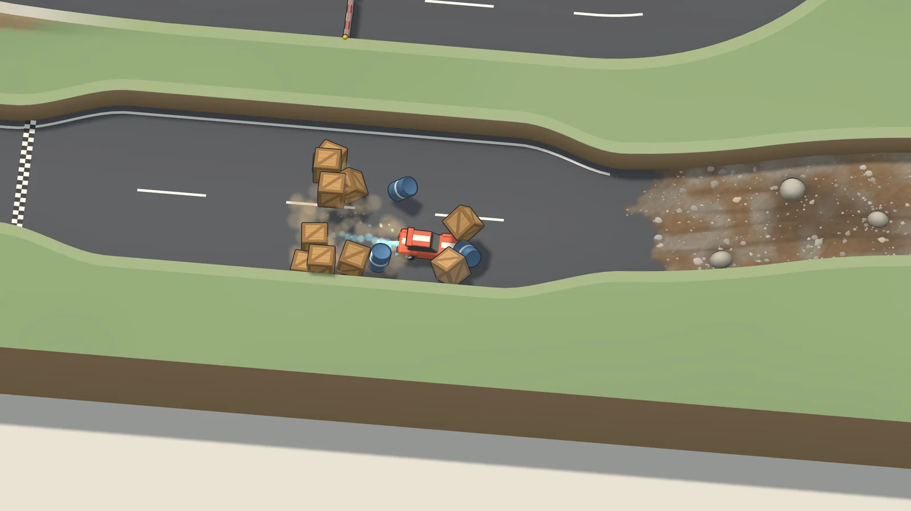
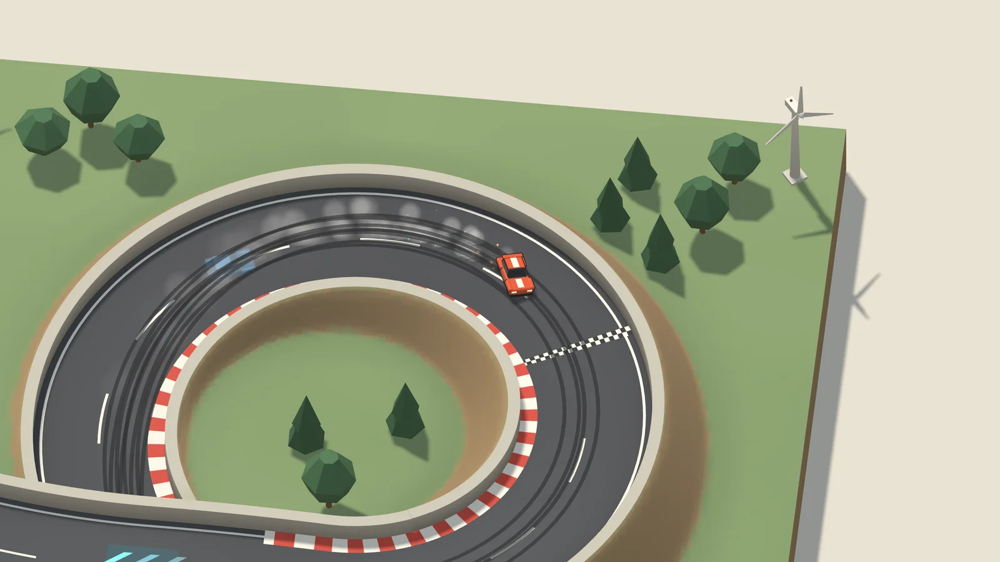

# Tabletop Grand Prix

**A time-attack racer on a toy track, against the whole world.** Every lap
you drive goes on one global leaderboard, and every lap on it can be raced:
pick any driver on the board and their ghost lines up beside you. Chase the
run just above yours, a rival, the world's fastest, or a field of ten at once.

<p align="center"><a href="https://tabletop-grand-prix.typeonce.games"><b>▶ Play Tabletop Grand Prix in your browser</b></a> · free, nothing to install</p>

<a href="docs/media/trailer.mp4">
  <picture>
    <source srcset="docs/media/tabletop-grand-prix.avif" type="image/avif">
    
  </picture>
</a>

<p align="center"><sub>One lap, alone, then against a ghost from the board, then against a whole field of them. <a href="docs/media/trailer.mp4">Watch the 25-second trailer</a>.</sub></p>

## Race the world

There is one leaderboard, and everyone who plays is on it. Click any row and
that lap becomes your ghost: the driver one place above you, a rival, or
the world record. Each ghost is that driver's real lap, played back beside
you, so you can see exactly where they brake, where they drift, and where
you lose the time.


Finish a lap and it plays again as a replay, with the board open beside it
and your row sliding up if you gained places. You get a name the first time
you post a lap (three words, like *Shy Otter Skids*), and you can change it
whenever you like. Every time on the board is real: the server drives each
submitted lap again from its inputs before it counts.

## Race the pack

By default you race the run just above yours, so there is always someone to
catch. Want more company? Race a field of five or ten ghosts from the board
at once, each in its own colour, and see each name flash as you pass it.

<table>
  <tr>
    <td></td>
    <td></td>
  </tr>
  <tr>
    <td align="center"><sub>one ghost: the run just above yours, right behind you</sub></td>
    <td align="center"><sub>a whole field of ghosts (a hundred, for the trailer)</sub></td>
  </tr>
</table>

## Set the fastest lap

The whole track fits on one screen, a tabletop circuit seen from above.
Boost pads, a jump over a gap, a ford through a pond, tall grass, a stony
path, and a spiral that climbs back over itself. A lap takes about half a
minute: beat 0:30 for bronze, 0:26 for silver, and 0:23 for gold. `R` starts
again at once.


## Everything moves

Nothing on the track is painted on. Balls roll, crate walls break apart,
barrels scatter, rocks on the stony path throw the car into a hop, the
grass bends under the wheels and springs back, and the ford leaves tyre
marks behind you.

<table>
  <tr>
    <td></td>
    <td></td>
  </tr>
  <tr>
    <td align="center"><sub>smash through the crate wall</sub></td>
    <td align="center"><sub>clear the gap</sub></td>
  </tr>
</table>

## Drift

Hold gas and brake together through a turn and the car slides round it on
a tight arc, leaving its marks on the road. Let go at the right time and
the drift pays you back with a push. On a keyboard it is one key, `Z`.



## Play

**[Play Tabletop Grand Prix at tabletop-grand-prix.typeonce.games](https://tabletop-grand-prix.typeonce.games).**
It runs in the browser on a computer, with a keyboard or a gamepad, on
WebGPU where the browser has it and WebGL elsewhere.

| | Keyboard | Gamepad |
| --- | --- | --- |
| Gas | `↑` or `W` | right trigger or A |
| Brake | `↓` or `S` | left trigger or B |
| Steer | `←` `→` or `A` `D` | left stick or d-pad |
| Drift | `Z` | right bumper |
| Start again | `R` | Y or Start |
| Sound on or off | `M` | left stick click |

Made by [Sandro Maglione](https://typeonce.games) with
[ritmo](https://ritmo.typeonce.dev) and [PixiJS 3D](https://pixijs.com/3d).
To run it yourself:

```sh
pnpm install
pnpm dev
```

## License

Apache License 2.0, see [LICENSE](LICENSE). Any copy or derivative work must keep the [NOTICE](NOTICE), which credits Sandro Maglione at [typeonce.games](https://typeonce.games). The Typeonce name and logo and the PixiJS logo are not covered by the license.

---

[Developing](DEVELOPMENT.md) · [The design](docs/design.md) · [The leaderboard server](docs/server.md) · [More games](https://typeonce.games)
